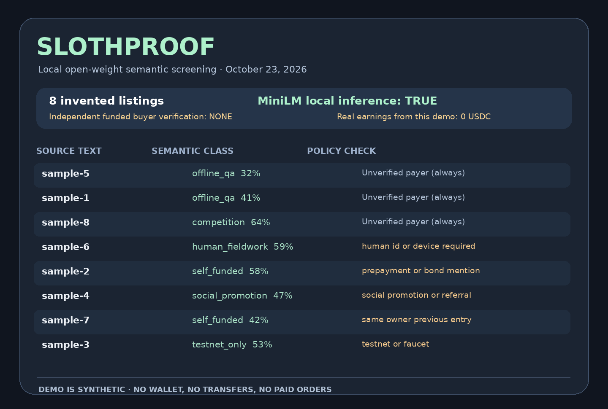

# SlothProof — a local AI filter for misleading USDC job listings

**New original project started October 23, 2026**, within the DEV × MLH Hacktoberfest Week 3 ("Slow and Steady") build window. Original one-human owner, AI-assisted engineering.

Sloths should not read 50 crypto bounties to discover that 43 demand a payment, a selfie, or testnet faucet tokens. SlothProof is a conservative, local-first job-list screener: an **open-weight MiniLM sentence embedding model** identifies what each listing is *about*, while a separate deterministic policy flags obvious financial, legal or one-owner repeat-application gates.

The tool NEVER classifies a posting as funded or paid just because the copy says "escrowed". Every output says escrow, client payment and wallet receipt remain **unverified**. It never operates a crypto wallet.

## For real x402 API sellers: scoped Base USDC checkout diagnostics

[**Buyer guide — one HTTP 402/OPTIONS regression pilot for 5 Base USDC, or an expanded offline QA scope for 19 Base USDC**](https://livastic-vm3-primary-tmp-260920.github.io/slothproof-20261023/x402-base-usdc-qa.html) · [public source page](docs/x402-base-usdc-qa.html).

This is a separately scoped, **manual proposal**, not an automatic SlothProof charge or certification. A customer sends only sanitized public 402/CORS/OpenAPI evidence, and the original single human owner transparently uses substantial AI assistance to produce reproducible synthetic tests and a Markdown report. **No user wallet connection, signed payload, private key or advance transfer is requested**; pricing, payout rail, delivery and refund terms require the buyer's written agreement before work starts. Links to existing free example traces, the original email intake and the original GitHub issue template are on the buyer page. A listing, email click or proposal is not an order or actual income.

## Run

Node.js 20 or newer. First run downloads the open-weight model once into the ignored .model-cache folder.

    npm ci --no-audit --no-fund
    npm test
    npm run demo > demo.json

The first run requires network access **only to fetch the model**; descriptions and outputs remain local. Afterwards run with remote model fetching disabled:

    npm run offline > offline.json

The included 8 demo ads are synthetic and use example.invalid; they are NOT real jobs, customers, receipts, wallet assets or bounty offers.

## DEV Week 3 published entry

Published October 23, 2026 with both official DEV challenge tags: [SlothProof contest submission](https://dev.to/livasticvm3primarytmp260920/slothproof-a-lazy-local-ai-that-questions-funded-usdc-bounties-1fjo). This is a verified published project post, **not** an award or earned cash; any human eligibility, tax paperwork and prize distribution remain unverified. The full author draft and reproducibility links are in submission/dev-week3-entry.md.

## Analyze one real public listing locally

The hosted [demo](https://livastic-vm3-primary-tmp-260920.github.io/slothproof-20261023/) now has an additional **public-text input form**. Paste a *public* title and requirements, choose the nominal currency/network, and indicate whether your single beneficial owner already applied under another VM/account. Then run actual local MiniLM inference and receive the explicit deterministic stop reasons.

The form is deliberately **NOT** a wallet, crawler, customer CRM, payment recipient verifier, API client, log-upload feature, or automated job claimant. It does not fetch the advertised URL, upload the description, call external employer services or store what you typed. The initial download of the open-weight model and runtime scripts still uses public CDNs. Do not paste private HARs, customer data, API keys, cookies, signed x402 headers or secrets. Known credential-like phrases are rejected before model inference, but the filter cannot guarantee detection of all sensitive data. All inputs must already be public and nonsecret.

Try **Load a synthetic example** for a safe reproducible browser demonstration. The input form uses the exact same byte-identical business policy and validation modules as the tested Node source. The supported npm test command now includes local validation, secret-filter, escaping and static-module parity tests. All output still states verified buyer payment and wallet receipts are **not determined by this tool**.

## Uncertain-topic abstention (October 23 update)

A highest-similarity label is not automatically a trustworthy classification. The
new `src/quality.mjs` checks two *heuristics* on the top two local model scores:
if the highest cosine similarity is below 0.35, or its advantage over the next
prototype is below 0.045, the page shows **uncertain topic** and the unmodified
raw top match. These values are transparent presentation thresholds, not
statistically calibrated probabilities. For the real eight invented examples,
a low-similarity Foundry request now abstains; the stronger x402 QA example
still suggests offline QA. Both retain the same independent payer/escrow/receipt
stop gates. `npm test` covers ambiguous, near-tied, invalid and distinct inputs;
`docs/quality.mjs` is byte-for-byte synced to the tested Node module.

**Nothing about this upgrade is a user-payment check or a claim of prize money.**

## Model is actually used

- Model: Xenova/all-MiniLM-L6-v2 (a port of the 384-dimensional open-weight sentence embedding model; review the model card and its upstream license).
- Implementation: Hugging Face Transformers.js, MIT/Apache-licensed ecosystem.
- Input: sanitized/public listings only; embeddings are computed on CPU.
- Embeddings: average token pooling with L2 normalization; cosine scores against eight example job archetypes.
- Labels: offline QA, development, self-funded offer, testnet, human fieldwork, social promotion, writing, competition.
- Policy: independent, inspectable checks for bond, owner duplicate, testnet, expired deadline and human-only eligibility. Semantic score never overrides hard gates.

## Separate existing paid offline QA services (no site checkout)

The demo now includes a clearly optional existing-original-owner sales section. The free semantic checker remains available without purchase. A genuine independent x402 developer may request an uncommitted written 5 native Circle Base USDC synthetic-only QA pilot through the seller's [already published contact route](mailto:onecursor1@gmail.com?subject=x402%20offline%20QA%20-%205%20or%2019%20Base%20USDC), or open the existing [19-USDC scoped GitHub inquiry](https://github.com/livastic-vm3-primary-tmp-260920/defi-payment-proof-qa/issues/new?template=x402-offline-qa-19-base-usdc.yml). Both are requests to discuss an independently funded paid contract, not an automatically accepted invoice or permission to send customer secrets.

The operator's existing [Soul.Markets public service catalog](https://api.soul.mds.markets/v1/soul/vm3-usdc-receipt-qa) currently lists five buyer-initiated, separately priced USDC public-data QA services. This direct JSON link is a read-only, first-party catalog, not a fictitious payment portal. The Soul seller platform charges a commission and has a custodial payout threshold, so an order or balance is NOT a verified original wallet receipt. As of this update there are zero confirmed independent buyers, orders and new paid settlements from this program. The source of each link and the nonbinding terms are recorded in the static docs/paid-offers.json file and enforced with test/offers.test.mjs.

## Existing VM3 original x402 quote QA — indexed for independent buyers (not SlothProof payment)

The same one-human economic operator has a separate **already-live original VM3 x402 Public Quote QA** service hosted on its existing VM5 x402 merchant: [free synthetic sample](https://vm5-openapi-x402.onrender.com/v1/x402-sample), [actual paid HTTP402 GET](https://vm5-openapi-x402.onrender.com/v1/x402-preflight), and **[one published Agent Bazaar discovery resource](https://bazaar.saylorinnovations.com/resources/69298)**. Its authentic x402 v2 challenge costs **0.010000 native Base Circle USDC** per real buyer-paid use. The accepted machine-readable two-resource public manifest (two distinct paid routes of the same one human owner) is at [x402-vm3-quote-manifest.json](https://livastic-vm3-primary-tmp-260920.github.io/slothproof-20261023/x402-vm3-quote-manifest.json) and is checked against the actual unpaid server challenge; this repository does **not** collect customer payments. The existing VM5 merchant wallet (same human owner) receives a payment **only if a different actual buyer signs and settles a real call**; that payee differs from the original VM1 MetaMask. Listing/discovery, the free sample, a 402 quote, and a test run alone are **not a sale or new USDC income**. This does not alter SlothProof's free local model, previously posted original services, or contest results.

## What it refuses to do

1. No wallet signing, approving, spending, bridging, or key handling.
2. No calls to a job board, client API, GitHub account, Google, email or smart contract.
3. No statement of escrow proof, actual buyer assent or verified final USDC transfer.
4. No seller-identity fabrication or self-referral farm.
5. No network fetch for input rows. Only the model weights can be fetched at first-run setup.
6. No sending customer traces, personal files or paid API credentials to an AI provider.

## Design trade-off

Conservative screening sacrifices some good leads. That is intentional: it is a reading assistant, not a due-diligence oracle. Open weights make local, repeatable retrieval possible and keep potentially sensitive job notes off a proprietary hosted LLM, while the human/owner can inspect the concrete stop rules separately. The top semantic label is fallible and should be reviewed; money stays zero until independently verified.

## Demo, benchmarks & claims

- Real CLI output is generated with npm run demo from the eight entirely synthetic listings.
- All scores come from a real local MiniLM inference run (not a hand-authored score or hardcoded results).
- CLI emits model id, inference flag, every reason and zero verified income.
- The proof images/demo are rendered from actual output and are illustrative of this local prototype only.
- For an actual opportunity, independently verify original buyer escrow, legal/AI/identity eligibility, supported asset and chain, acceptance terms, taxes, labor time and final wallet transfer.

## New project & contest integrity

Every source file in this folder was newly authored during the Week 3 2026 entry period; it is not a repackaged earlier script or a PR to another project. General inspiration comes from the team's prior first-hand experience screening public crypto gigs, but no old code or private account material has been copied. Contest participation and any payout require the **actual human owner's age 18+ and real KYC/tax eligibility**; prize selection is competitive, not guaranteed and not earned by publishing.

MIT code license (LICENSE). Model weights are never committed and retain their upstream license. This project is original AI-assisted software operated by one actual human economic owner, not a claim of human-unaided authorship.

## Actual paid TapeOut x402 resource links — 24 October 2026

The one human owner also maintains a separate **existing VM5-hosted merchant API**, whose two
distinct public TapeOut CPU0 x402 resources now pay **directly to the original VM1 MetaMask**
EVM public receiver `0x4e3106520E40af30870caFE78da1B1e7110eD98E` (Base chain 8453; native Circle USDC contract
`0x833589fCD6eDb6E08f4c7C32D4f71b54bdA02913`).

- [One-block CPU0 report](https://vm5-openapi-x402.onrender.com/v1/tapeout-cpu0-report):
  0.005 USDC per authorized delivered request (HTTP402 unpaid quote).
- [Two-pinned-block CPU0 change-only report](https://vm5-openapi-x402.onrender.com/v1/tapeout-cpu0-diff):
  0.010 USDC per authorized delivered request (HTTP402 unpaid quote).
- [Free **fictional** JSON example](https://vm5-openapi-x402.onrender.com/v1/tapeout-cpu0-diff-sample).
- [Agent Bazaar public listing of the original VM1-payable 0.01 Base USDC diff](https://bazaar.saylorinnovations.com/resources/69299) — published, **not** a verified sale.
- [x402dash independent registered endpoint index](https://api.x402dash.com/v1/endpoints?q=tapeout-cpu0-diff) — verified catalog entry, no buyer yet.
- [Public buyer-facing technical explanation](https://livastic-vm3-primary-tmp-260920.github.io/slothproof-20261023/tapeout-cpu0-diff.html)
  stored locally as `docs/tapeout-cpu0-diff.html`.

The two-block source state was read independently by the operator at pinned X Layer
chain 196 block numbers 73915245 and 74009771, with 2 of 20 selected fields
different. This is a narrowly scoped historical comparison, **not** an exploit,
audit assurance, live market quote, promised gain, approval to sign a wallet,
new customer purchase or net-profit receipt.

The older snapshot was independently bought on earlier dates by genuine
third-party verification scouts; the new 0.01 resource has **no independently
observed paid buyer** in the inspected settlement summaries. One-owner websites
and marketplace submissions are not new revenues; keep all transaction-hash
attribution in the original owner ledger, never count the same paid scout twice.
Static SlothProof is not a checkout and never accesses wallet keys.
